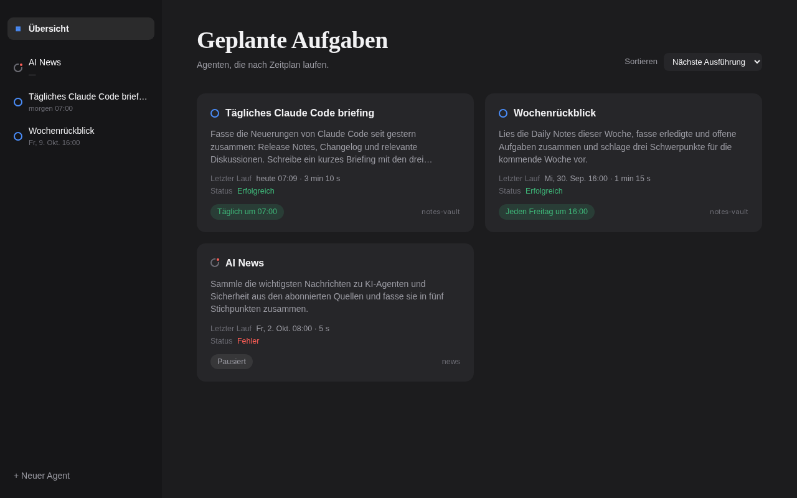
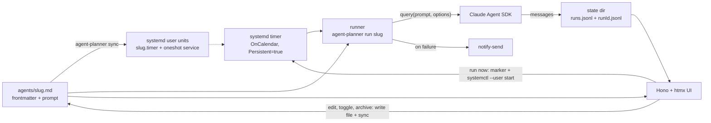
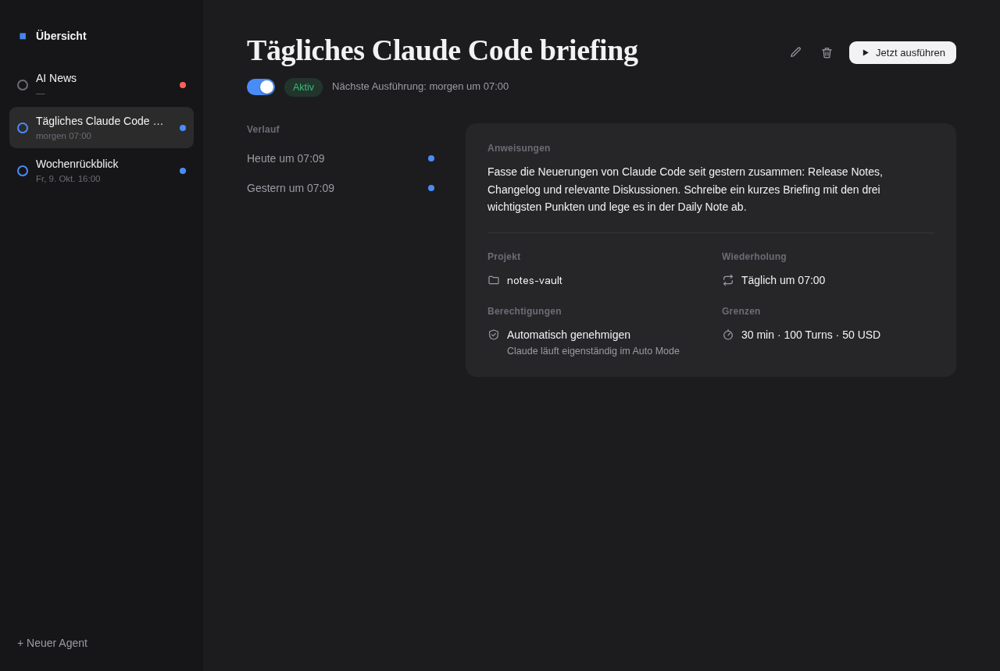

# agent-planner

Scheduled Claude agents on Linux: systemd timers start the Claude Agent SDK, every run is logged to disk, and a small Hono + htmx web UI shows, edits and triggers the agents.



## Problem

Recurring tasks (a morning briefing, a weekly review, a repo status report) are good candidates for an agent, but a cron job that calls an LLM leaves open: did it run, what did it do, what did it cost, and what is it allowed to touch? agent-planner turns each recurring task into one Markdown file and answers those questions with systemd (scheduling, timeouts), per-run logs and a UI.

## What it does

- **One file per agent.** `<slug>.md` holds frontmatter (name, cron, working directory, limits) and the prompt as body.
- **`sync` generates systemd user units** from those files: one `agent-planner@<slug>.timer` per agent plus a shared `agent-planner@.service` template (`Type=oneshot`). Cron expressions are translated to `OnCalendar=`; `systemd-analyze` validates the result. Units of agents whose file is gone are removed.
- **`run <slug>` executes one agent** through the Agent SDK (`query()`), with a timeout, a turn limit and a budget limit per agent. Every SDK message is written to a log; the outcome is `success`, `error`, `timeout`, `stopped` or `auth_missing`.
- **Failure notification:** on `error`, `timeout` or `auth_missing` the runner calls `notify-send` (skipped silently if it is missing).
- **Web UI** (Hono, server-rendered, htmx): overview with next/last run, agent detail with run history and tool calls, create/edit/enable/disable/archive, "run now", starter templates (`templates/`).
- **Cron warnings:** schedules that never fire (for example `0 9 30 2 *`) are reported by the CLI and the form.

## Architecture



Source map: `src/agent.ts` (file format), `src/cron.ts` (cron to `OnCalendar`), `src/units.ts` (unit generation), `src/runner.ts` (SDK run, timeout, SIGTERM handling), `src/log.ts` (run log), `src/actions.ts` (UI actions), `src/web/` (app, guard, routes), `bin/agent-planner` (CLI).

## Quickstart

Requirements: Linux with systemd user services, [bun](https://bun.sh), [just](https://github.com/casey/just) (optional), and for real runs an Anthropic-compatible endpoint plus token.

```sh
bun install
just dev        # web UI on http://127.0.0.1:4317 with demo agents (demo/) and no real units
just test       # tsc --noEmit, then bun test
```

Run real agents:

```sh
# 1. Give the systemd user manager the credentials (names only; values come from your shell)
systemctl --user import-environment ANTHROPIC_BASE_URL ANTHROPIC_AUTH_TOKEN

# 2. Put agent files in a folder and create timers
export AGENT_PLANNER_DIR=~/agents
bun bin/agent-planner sync          # or: just sync

# 3. Run one agent by hand
bun bin/agent-planner run daily-briefing --manual
```

Run the UI as a service: copy `.env.example` to `~/.config/agent-planner/web.env`, edit it, then `just install`. The unit (`systemd/agent-planner-web.service`) expects the repo at `~/git/agent-planner` and bun at the mise `latest` path; adjust `WorkingDirectory` and `ExecStart` otherwise.

CLI:

```
agent-planner sync [--dir <folder>] [--force]    generate/update units from agent files
agent-planner run <slug> [--manual] [--dir ..]   run one agent
agent-planner validate-cron '<expression>'       validate, print OnCalendar and a readable form
```

## Configuration

| Variable | Meaning |
|---|---|
| `AGENT_PLANNER_DIR` | Agent folder (or `--dir`). Required for CLI and UI. |
| `AGENT_PLANNER_STATE` | State folder, default `~/.local/state/agent-planner`. |
| `AGENT_PLANNER_TEMPLATES` | Template folder, default `templates/` in the repo. |
| `AGENT_PLANNER_DEFAULT_CWD` | Working directory pre-filled in the new-agent form. |
| `AGENT_PLANNER_PORT`, `AGENT_PLANNER_HOST` | UI port (4317) and bind address (`127.0.0.1`). |
| `AGENT_PLANNER_ALLOWED_CLIENTS` | Comma list of IPv4 CIDRs allowed to reach the UI besides loopback. |
| `AGENT_PLANNER_ALLOWED_HOSTS` | Comma list of `host:port` accepted in the `Host` header besides loopback. |
| `AGENT_PLANNER_UNIT_DIR`, `AGENT_PLANNER_SYSTEMCTL` | Redirect unit files / the `systemctl` command (demo, screenshots). |
| `AGENT_PLANNER_DEMO`, `AGENT_PLANNER_TRIGGER` | Demo mode; `manual` marks the run as manually triggered. |
| `ANTHROPIC_BASE_URL`, `ANTHROPIC_AUTH_TOKEN` | Required at run time; without them the run ends as `auth_missing` and the SDK is never called. |

`.env.example` lists the UI service settings.

## Example agent

`agents/daily-briefing.md` (frontmatter fields: `name`, `cron`, `cwd` required; `model`, `enabled` = true, `timeout` in minutes = 30, `maxTurns` = 100, `maxBudgetUsd` = 50):

```markdown
---
name: "Daily briefing"
cron: "0 7 * * *"
cwd: "~/notes"
timeout: 30
maxTurns: 100
maxBudgetUsd: 5
---
Summarize what changed in my project since yesterday and write three bullet points
into today's daily note.
```

`sync` turns this into `agent-planner@daily-briefing.timer` (`OnCalendar=*-*-* 07:00:00`, `Persistent=true`) and a drop-in with `TimeoutStartSec` (limit plus 60 s). The slug is the file name without `.md`. More examples: `demo/agents/`, `templates/`.



## Run log format

```
<state>/<slug>/runs.jsonl      index, one JSON line per event (a start line, then an end line with the same runId)
<state>/<slug>/<runId>.jsonl   every SDK message of the run, unchanged, one per line
<state>/<slug>/manual          empty marker: the next run counts as manual (valid for 60 s)
```

```json
{"runId":"20261006T084300-ab12cd","slug":"morning","trigger":"schedule","start":"2026-10-06T08:43:00.000Z","end":"2026-10-06T08:43:09.000Z","durationMs":9000,"status":"success","costUsd":0.004,"turns":1,"sessionId":"..."}
```

Lines are only appended. A `running` line whose process no longer exists counts as `timeout`. Readers: `listRuns(slug)` and `lastRun(slug)` in `src/log.ts`.

## Security notes

- **Agents act with your user's rights.** The runner starts the SDK with `permissionMode: "auto"`, `cwd` set to the agent's folder and the per-agent `maxTurns` / `maxBudgetUsd` / timeout. There is no tool allow-list in agent-planner: whoever can create or edit an agent can make it run commands as that user. Treat the agent folder like code.
- **The UI has no login.** It binds to `127.0.0.1` by default. Every request is checked by a guard (`src/web/guard.ts`): source IP must be loopback or inside `AGENT_PLANNER_ALLOWED_CLIENTS` (requests without a known source IP are rejected; a prefix shorter than `/8` or an invalid entry prevents start-up), the `Host` header must be in the allow-list (DNS rebinding), and writing requests need `HX-Request: true` and a same-origin `Origin` / `Sec-Fetch-Site` (CSRF).
- **Network exposure.** Binding to `0.0.0.0` makes every device in the allowed networks able to create, change and start agents. Do not expose it beyond a network you trust; put a login or reverse proxy in front before doing so. Check the source-IP allow-list against your VPN setup: a VPN can accept traffic before your firewall does, so the allow-list, not the firewall, is the boundary implemented here.
- **Rendering.** Prompts and agent output are rendered as Markdown with raw HTML escaped, only `http(s)`/`mailto`/relative links, and images shown as links (`src/web/markdown.ts`).
- **Logs contain full agent output.** State folders are created with mode `0700`, log files with `0600`.
- **Credentials.** `import-environment` makes `ANTHROPIC_AUTH_TOKEN` visible to all services of the user manager (`systemctl --user show-environment`). Remove it with `systemctl --user unset-environment ANTHROPIC_AUTH_TOKEN`.
- **Missed runs cost money.** Timers use `Persistent=true`: a run missed while the machine was off is made up once at the next start.

## Status and limits

- Works for one user on one Linux machine with systemd user services. The tests need `systemd-analyze` (they pass on Linux, 216 tests; several fail on macOS).
- The web UI text is German.
- Prompts in `templates/` and `demo/` are written for a Markdown/Obsidian-style notes folder; adapt `cwd` and prompt to your setup.
- No authentication, no multi-user support, no retry of failed runs, no cost aggregation across runs (cost is read from each SDK result).
- A user session may be needed for the credentials: runs that `Persistent=true` triggers right at login can end as `auth_missing` until the environment has been imported.
- Development history: `openspec/changes/` holds the proposal, spec and tasks of each change; `docs/belege/` holds acceptance evidence (screenshots from demo data).

## License

[MIT](LICENSE)
